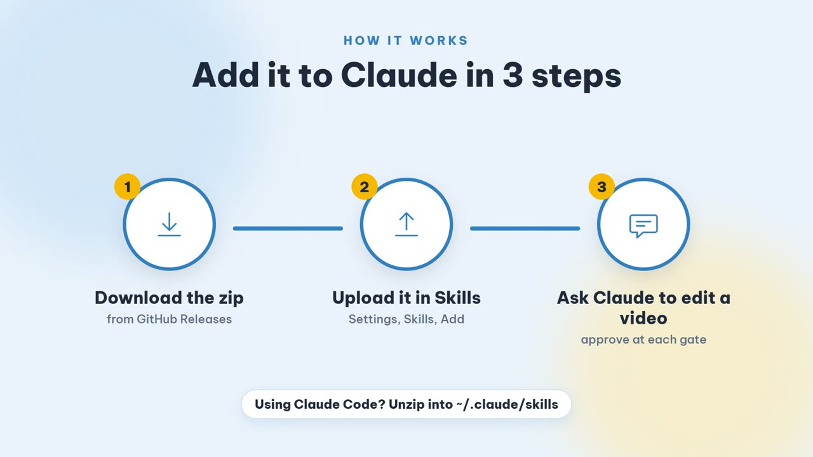

<p align="center">
  
</p>

<h1 align="center">narrated-video-edit</h1>

<p align="center">
  An agent skill that turns a clip with a voice in it into a designer-style social video.<br>
  Local transcription, per-word captions, licensed B-roll, stickers, 190 effects, an independent audit.
</p>

<p align="center">
  <a href="LICENSE"></a>
  <a href="../../releases/latest"></a>
  <a href="https://agentskills.io/specification"></a>
  
</p>

<p align="center">
  <a href="README.md">Tiếng Việt</a> | <b>English</b>
</p>

---

## Read this first

This is a **starting point, not a finished product, and it is not guaranteed to work on the first try.** It chains many tools (FFmpeg, Chrome, Python models, public image APIs) and the machine, the footage and the language you bring will all differ from the ones it was developed on. Expect to run the self-test, read an error or two, and adjust.

That is by design. The skill is plain files: Markdown instructions, JSON data tables and small Node scripts. Take it home and **tune it to your own needs**: change the caption styles, the effect budget, the fonts and colors, the asset sources, the questions it asks. [docs/CUSTOMIZE.en.md](docs/CUSTOMIZE.en.md) shows where each knob lives.

It was developed and tested on **Windows 11**. macOS and Linux have not been tried.

## Watch

| | English | Tiếng Việt (default) |
| --- | --- | --- |
| **What it makes** (showreel, 27 s, with music) | [Watch](docs/media/showreel-en.mp4) | [Xem](docs/media/showreel-vi.mp4) |
| **Add it to Claude in three steps** (tutorial, 45 s, with music) | [Watch](docs/media/install-guide-en.mp4) | [Xem](docs/media/install-guide-vi.mp4) |

[](docs/media/install-guide-en.mp4)

## What it does

You give it a video with someone speaking, or a voice-over. It produces a vertical (9:16) or horizontal video with:

- **Word-by-word captions** that highlight the word being spoken, in six presets (`bold`, `kinetic`, `pill`, `marker`, `minimal`, `editorial`). Fonts with Vietnamese diacritics are bundled.
- **B-roll that matches what is said**, shown as designed objects (card, polaroid, picture-in-picture, sticker, peek, stack) over a speaker who keeps moving. Images come only from sources with a license the skill accepts (CC0, public domain, CC BY), and every file gets a credit line.
- **Stickers, animated emoji, number cards, lower thirds, zoom on emphasis, sound effects**, chosen from the words actually spoken. Numbers on screen must appear in the speech; nothing is invented.
- **A library of 190 effects in 11 families**, each one run and measured by `effects-selftest.mjs` (outside the effect window the frame must stay identical, inside it must change, no black corners, no more than three flashes per second).
- **Face-aware layouts**: a face detector keeps cards off the speaker; `--layout follow` crops 9:16 around the face; text can sit *behind* the speaker through person segmentation.
- **Loudness normalised to -14 LUFS**, an `.srt` file and an `out.credits.txt` to paste into the video description.
- **An independent audit** that re-transcribes the finished audio, checks caption coverage and timing, flicker, safe zones and overlay completeness, and exits non-zero if something is wrong.

Everything runs on your machine except the image search, which sends short English keywords taken from your speech to public APIs. The skill tells you this before it does it. Your video and audio are never uploaded.

## How it works

| Stage | What happens | You decide |
| --- | --- | --- |
| 1. Intake and analysis | up to four questions with defaults; local transcription with `faster-whisper`; face, pause and shot detection | language, platform, style |
| 2. Plan | a skeleton plan (cuts, zooms, stickers, cards, B-roll queries, effects) is written and linted | **Gate 1:** you approve a storyboard image with timestamps |
| 3. Assets | licensed images are searched, downloaded and recorded in `credits.json` | **Gate 2:** you approve a contact sheet of the chosen images |
| 4. Build | FFmpeg builds the base layer; headless Chrome renders a transparent overlay; both are merged | |
| 5. Audit and delivery | independent measurements; the assistant must look at the result sheet | **Gate 3:** you get the video, subtitles and credits |

The three gates are mandatory: the assistant stops and asks. Only if you say "quick" or "choose for me" does it continue, and then it writes its assumptions into the report.

Three styles ship with the skill: `hype` (short, loud, 15 to 60 s), `explainer` (clean, 30 to 120 s) and `documentary` (calm, 60 to 180 s). Details are in [`references/`](skills/narrated-video-edit/references/).

## Install

Full steps, with troubleshooting: **[docs/INSTALL.en.md](docs/INSTALL.en.md)**. In short:

1. Download `narrated-video-edit-v1.0.0.zip` from the [latest release](../../releases/latest).
2. Add it where your assistant looks for skills:
   - **Claude (claude.ai or the desktop app):** open your account menu, then *Settings* (shown as *Customize*, then *Skills*, in some versions), then *Add*, then *Upload skill*, and drop the zip. Turn the skill on.
   - **Claude Code:** unzip into `~/.claude/skills/` so that `~/.claude/skills/narrated-video-edit/SKILL.md` exists, or into `.claude/skills/` inside a project.
   - **Antigravity CLI and other Agent Skills clients:** copy the `narrated-video-edit` folder into that client's skills folder.
3. Prepare the machine once (the skill cannot do this for you inside a chat sandbox):

   ```bash
   cd narrated-video-edit/scripts
   npm install
   node setup.mjs          # checks Node, ffmpeg, Chrome; creates an isolated Python .venv
   node selftest.mjs       # 68 checks on synthetic data; a few minutes, longer the first time (model download)
   ```

4. Ask your assistant: *"Use narrated-video-edit on ~/Videos/talk.mp4 for Reels, English, explainer style."*

### Requirements

| Needs | Why |
| --- | --- |
| Node.js 20 or newer | every script |
| `ffmpeg` and `ffprobe` on `PATH` | cutting, effects, loudness, encoding |
| Google Chrome (or set `CHROME_PATH`) | renders the overlay layer |
| Python 3.11 or newer (or `uv`) | isolated `.venv` with `faster-whisper` and `opencv-python-headless` |
| About 3 GB of disk for the first run | the Whisper `large-v3` model is downloaded once |
| A GPU (optional) | faster transcription; the CPU path works |

> **Where it can run.** The skill must run commands and open Chrome on a machine you control. It has been used with **Claude Code** and **Antigravity CLI**. In a plain claude.ai chat or the desktop app the skill uploads and loads, but whether its tools can run depends on what the code-execution sandbox offers (Chrome, FFmpeg, a model download, network access). That path has not been tested.

## Known limits

- Tested on Windows 11 only.
- Vietnamese was tried on a real 13-minute vlog; English on synthetic narration. Other languages depend on Whisper and have not been tried.
- No active-speaker detection when several faces are on screen.
- On extreme close-ups the "text behind the speaker" effect is mostly hidden.
- Public image sources are not commercial stock: expect thin results for abstract topics, and 480p clips from Wikimedia. The skill drops a B-roll slot instead of pasting a wrong image.
- The skill's own instructions (`SKILL.md` and `references/`) are written in **Vietnamese**, the project's default language. The assistant still talks to you in your language, but there is no English version of those instructions yet; one would be a good first contribution.
- It does not download videos from YouTube, TikTok or Instagram, and refuses to. That is a rule, not a bug.

## Repository layout

```
skills/narrated-video-edit/   the skill itself (this folder is what the release zip contains)
  SKILL.md                    entry point the assistant reads
  references/                 12 guides: intake, planning, licenses, audit, pitfalls, effects...
  data/                       styles, effects (JSON), brands, decor and asset sources
  scripts/                    Node tools and Python helpers
  templates/                  overlay page, fonts, emoji, models, vendored GSAP and lottie
  fixtures/                   narration used by the self-test
docs/                         install, customise, media, and the sources of the videos
tools/                        validate-skill.mjs and build-release.mjs
.github/                      issue and pull request templates
```

## Credits and thanks

This project stands on FFmpeg, OpenAI Whisper, faster-whisper, OpenCV and YuNet, MediaPipe, Playwright, GSAP, lottie-web, Noto Emoji, Fluent Emoji, Iconify, five open-licensed typefaces, public image collections from Wikimedia, Openverse, NASA and the Cleveland Museum of Art, and the work of creators who teach editing in public. **Names, licenses and exactly what each is used for are in [CREDITS.en.md](CREDITS.en.md)**; license texts of bundled files are next to the files, and a summary is in [NOTICE](NOTICE). Background music in the videos: "Music Promotion" by MiroMaxMusic on Pixabay.

## Contributing, security, license

Pull requests are welcome, especially: an English translation of the skill instructions, macOS and Linux fixes, new effects, new asset sources. See [CONTRIBUTING.md](CONTRIBUTING.md). Report vulnerabilities as described in [SECURITY.md](SECURITY.md). Everyone taking part is expected to follow the [Code of Conduct](CODE_OF_CONDUCT.md).

Released under the [MIT License](LICENSE). Third-party material keeps its own license (see [CREDITS.en.md](CREDITS.en.md)).

This project is independent. It is not affiliated with or endorsed by Anthropic, Google or any other company named in it.
