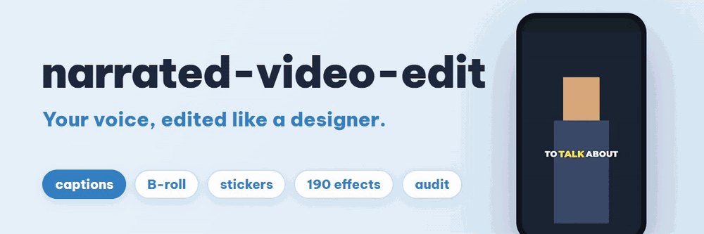
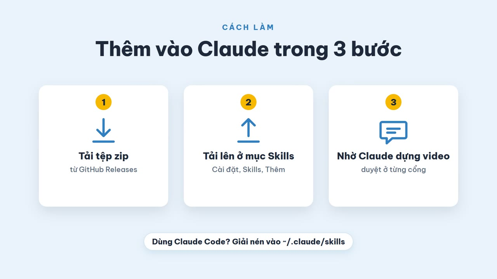

<p align="center">
  
</p>

<h1 align="center">narrated-video-edit</h1>

<p align="center">
  Skill cho trợ lý AI: biến một clip có giọng nói thành video social kiểu editor thiết kế.<br>
  Phiên âm cục bộ, caption từng từ, B-roll có giấy phép, sticker, 190 hiệu ứng, kiểm toán độc lập.
</p>

<p align="center">
  <a href="LICENSE"></a>
  <a href="../../releases/latest"></a>
  <a href="https://agentskills.io/specification"></a>
  
</p>

<p align="center">
  <a href="README.md">English</a> | <b>Tiếng Việt</b>
</p>

---

## Đọc trước khi dùng

Đây là **điểm khởi đầu, không phải sản phẩm hoàn chỉnh, và không bảo đảm chạy được ngay lần đầu.** Nó nối nhiều công cụ (FFmpeg, Chrome, mô hình Python, API ảnh công khai), còn máy, video và ngôn ngữ của bạn sẽ khác máy nơi nó được phát triển. Hãy chuẩn bị chạy self-test, đọc một hai thông báo lỗi và chỉnh lại.

Điều đó là chủ ý. Skill chỉ là tệp thường: hướng dẫn Markdown, bảng dữ liệu JSON và vài script Node nhỏ. Hãy mang về và **tinh chỉnh theo nhu cầu của bạn**: đổi kiểu caption, ngân sách hiệu ứng, phông và màu, nguồn tài nguyên, các câu nó hỏi. [docs/CUSTOMIZE.vi.md](docs/CUSTOMIZE.vi.md) chỉ chỗ từng núm vặn nằm ở đâu.

Skill được phát triển và thử trên **Windows 11**. macOS và Linux chưa thử.

## Xem

| | English | Tiếng Việt |
| --- | --- | --- |
| **Nó làm ra gì** (showreel 30 giây, có nhạc) | [Watch](docs/media/showreel-en.mp4) | [Xem](docs/media/showreel-vi.mp4) |
| **Thêm vào Claude trong ba bước** (hướng dẫn 45 giây, có nhạc) | [Watch](docs/media/install-guide-en.mp4) | [Xem](docs/media/install-guide-vi.mp4) |

[](docs/media/install-guide-vi.mp4)

## Skill làm được gì

Bạn đưa một video có người nói hoặc giọng đọc. Skill trả về video dọc (9:16) hoặc ngang với:

- **Caption từng từ** nhấn từ đang được nói, sáu preset (`bold`, `kinetic`, `pill`, `marker`, `minimal`, `editorial`). Có sẵn phông hỗ trợ dấu tiếng Việt.
- **B-roll khớp lời nói**, hiện như vật thể thiết kế (thẻ, polaroid, hình trong hình, sticker, thẻ ló, chồng thẻ) đè lên người nói vẫn chạy liên tục. Ảnh chỉ lấy từ nguồn có giấy phép skill chấp nhận (CC0, miền công cộng, CC BY), và mỗi tệp có một dòng ghi công.
- **Sticker, emoji động, thẻ số liệu, lower third, zoom nhấn, hiệu ứng âm thanh**, chọn theo đúng lời đã nói. Số trên màn hình phải có trong lời nói; không bịa gì.
- **Thư viện 190 hiệu ứng, 11 họ**, từng cái được `effects-selftest.mjs` chạy thật và đo (ngoài cửa sổ hiệu ứng khung phải giữ nguyên, trong cửa sổ phải đổi, không lộ góc đen, không quá ba lần chớp sáng mỗi giây).
- **Bố cục nhận biết khuôn mặt**: bộ dò mặt giữ thẻ ra khỏi người nói; `--layout follow` cắt 9:16 bám theo mặt; chữ có thể nằm *sau* người nói nhờ tách người.
- **Độ to chuẩn hóa -14 LUFS**, tệp `.srt` và `out.credits.txt` để dán vào mô tả video.
- **Kiểm toán độc lập**: phiên âm lại âm thanh thành phẩm, kiểm độ phủ và thời điểm caption, chớp sáng, vùng an toàn, lớp phủ có đủ khung; thoát mã khác 0 nếu có gì sai.

Mọi thứ chạy trên máy bạn, trừ bước tìm ảnh: bước này gửi vài từ khóa tiếng Anh rút từ lời nói tới các API công khai. Skill báo bạn điều này trước khi làm. Video và âm thanh của bạn không bao giờ được tải lên.

## Cách hoạt động

| Giai đoạn | Việc xảy ra | Bạn quyết định |
| --- | --- | --- |
| 1. Hỏi và phân tích | tối đa bốn câu hỏi kèm mặc định; phiên âm cục bộ bằng `faster-whisper`; dò mặt, khoảng ngắt, đổi cảnh | ngôn ngữ, nền tảng, phong cách |
| 2. Lập kế hoạch | viết và kiểm bộ khung kế hoạch (cắt, zoom, sticker, thẻ, truy vấn B-roll, hiệu ứng) | **Cổng 1:** bạn duyệt ảnh storyboard có mốc giờ |
| 3. Tài nguyên | tìm, tải ảnh có giấy phép và ghi vào `credits.json` | **Cổng 2:** bạn duyệt ảnh tổng hợp các hình đã chọn |
| 4. Dựng | FFmpeg dựng lớp nền; Chrome không giao diện dựng lớp phủ trong suốt; ghép hai lớp | |
| 5. Kiểm toán và giao | đo độc lập; trợ lý phải xem ảnh kết quả | **Cổng 3:** bạn nhận video, phụ đề và ghi công |

Ba cổng là bắt buộc: trợ lý dừng lại và hỏi. Chỉ khi bạn nói "nhanh" hoặc "tự chọn giúp tôi" nó mới đi tiếp, và khi đó phải ghi giả định vào báo cáo.

Skill có ba phong cách: `hype` (ngắn, mạnh, 15 đến 60 giây), `explainer` (sạch, 30 đến 120 giây) và `documentary` (êm, 60 đến 180 giây). Chi tiết ở [`references/`](skills/narrated-video-edit/references/).

## Cài đặt

Các bước đầy đủ kèm xử lý lỗi: **[docs/INSTALL.vi.md](docs/INSTALL.vi.md)**. Tóm tắt:

1. Tải `narrated-video-edit-v1.0.0.zip` ở [bản phát hành mới nhất](../../releases/latest).
2. Thêm vào nơi trợ lý của bạn tìm skill:
   - **Claude (claude.ai hoặc ứng dụng máy tính):** mở menu tài khoản, chọn *Cài đặt* (ở một số phiên bản là *Customize*, rồi *Skills*), chọn *Thêm*, chọn *Tải Skill lên*, thả tệp zip vào. Bật skill.
   - **Claude Code:** giải nén vào `~/.claude/skills/` sao cho có `~/.claude/skills/narrated-video-edit/SKILL.md`, hoặc vào `.claude/skills/` trong một dự án.
   - **Antigravity CLI và các ứng dụng khách Agent Skills khác:** chép thư mục `narrated-video-edit` vào thư mục skill của ứng dụng đó.
3. Chuẩn bị máy một lần (skill không tự làm được việc này bên trong sandbox của một cuộc chat):

   ```bash
   cd narrated-video-edit/scripts
   npm install
   node setup.mjs          # kiểm Node, ffmpeg, Chrome; tạo .venv Python riêng
   node selftest.mjs       # 68 kiểm tra bằng dữ liệu tổng hợp; vài phút, lâu hơn ở lần đầu (tải mô hình)
   ```

4. Nhờ trợ lý: *"Dùng narrated-video-edit dựng video ~/Videos/talk.mp4 cho Reels, tiếng Việt, phong cách explainer."*

### Yêu cầu

| Cần | Để làm gì |
| --- | --- |
| Node.js 20 trở lên | mọi script |
| `ffmpeg` và `ffprobe` trong `PATH` | cắt, hiệu ứng, độ to, xuất video |
| Google Chrome (hoặc đặt `CHROME_PATH`) | dựng lớp phủ |
| Python 3.11 trở lên (hoặc `uv`) | `.venv` riêng có `faster-whisper` và `opencv-python-headless` |
| Khoảng 3 GB đĩa cho lần chạy đầu | mô hình Whisper `large-v3` tải một lần |
| GPU (tùy chọn) | phiên âm nhanh hơn; CPU vẫn chạy được |

> **Chạy được ở đâu.** Skill phải chạy lệnh và mở Chrome trên một máy bạn kiểm soát. Nó đã được dùng với **Claude Code** và **Antigravity CLI**. Trong một cuộc chat claude.ai thường hoặc ứng dụng máy tính, skill tải lên và nạp được, nhưng công cụ của nó có chạy nổi hay không còn tùy sandbox thực thi mã có gì (Chrome, FFmpeg, tải mô hình, truy cập mạng). Đường này chưa được thử.

## Giới hạn đã biết

- Chỉ thử trên Windows 11.
- Tiếng Việt đã thử trên một vlog thật 13 phút; tiếng Anh thử trên giọng đọc tổng hợp. Ngôn ngữ khác phụ thuộc Whisper và chưa thử.
- Chưa nhận biết ai đang nói khi có nhiều khuôn mặt trong khung.
- Ở cận cảnh quá gần, hiệu ứng "chữ sau người nói" gần như bị che hết.
- Kho ảnh công khai không phải stock thương mại: chủ đề trừu tượng thường ít kết quả, clip Wikimedia hay chỉ 480p. Skill bỏ ô B-roll thay vì dán ảnh sai.
- Hướng dẫn của chính skill (`SKILL.md` và `references/`) viết bằng **tiếng Việt**. Trợ lý nói chuyện với bạn bằng ngôn ngữ của bạn, nhưng muốn sửa các hướng dẫn đó bằng tiếng Anh thì bạn phải tự dịch. Bản tiếng Anh là một đóng góp đầu tiên rất tốt.
- Skill không tải video từ YouTube, TikTok hay Instagram và từ chối làm việc đó. Đó là quy tắc, không phải lỗi.

## Cấu trúc kho

```
skills/narrated-video-edit/   bản thân skill (thư mục này chính là nội dung zip phát hành)
  SKILL.md                    điểm vào để trợ lý đọc
  references/                 12 tài liệu: đầu vào, kế hoạch, giấy phép, kiểm toán, bẫy, hiệu ứng...
  data/                       phong cách, hiệu ứng (JSON), thương hiệu, nguồn decor và tài nguyên
  scripts/                    công cụ Node và trợ giúp Python
  templates/                  trang lớp phủ, phông, emoji, mô hình, GSAP và lottie kèm sẵn
  fixtures/                   giọng đọc dùng cho self-test
docs/                         cài đặt, tinh chỉnh, phương tiện và mã nguồn các video
tools/                        validate-skill.mjs và build-release.mjs
.github/                      mẫu issue và pull request, CI
```

## Ghi công và lời cảm ơn

Dự án đứng trên vai FFmpeg, OpenAI Whisper, faster-whisper, OpenCV và YuNet, MediaPipe, Playwright, GSAP, lottie-web, Noto Emoji, Fluent Emoji, Iconify, năm bộ phông giấy phép mở, các kho ảnh công khai của Wikimedia, Openverse, NASA và Bảo tàng Nghệ thuật Cleveland, cùng công sức của những người dạy dựng video công khai. **Tên, giấy phép và đúng việc mỗi nguồn được dùng vào nằm ở [CREDITS.vi.md](CREDITS.vi.md)**; văn bản giấy phép của tệp kèm theo nằm cạnh tệp, bản tóm tắt ở [NOTICE](NOTICE). Nhạc nền trong video: "Music Promotion" của MiroMaxMusic trên Pixabay.

## Đóng góp, bảo mật, giấy phép

Rất hoan nghênh pull request, đặc biệt: bản dịch tiếng Anh cho hướng dẫn của skill, sửa lỗi macOS và Linux, hiệu ứng mới, nguồn tài nguyên mới. Xem [CONTRIBUTING.md](CONTRIBUTING.md). Báo lỗ hổng bảo mật theo [SECURITY.md](SECURITY.md). Mọi người tham gia vui lòng tuân thủ [Quy tắc ứng xử](CODE_OF_CONDUCT.md).

Phát hành theo [Giấy phép MIT](LICENSE). Tài liệu bên thứ ba giữ giấy phép riêng (xem [CREDITS.vi.md](CREDITS.vi.md)).

Dự án này độc lập, không liên kết hay được bảo trợ bởi Anthropic, Google hay bất kỳ công ty nào được nhắc tới.
